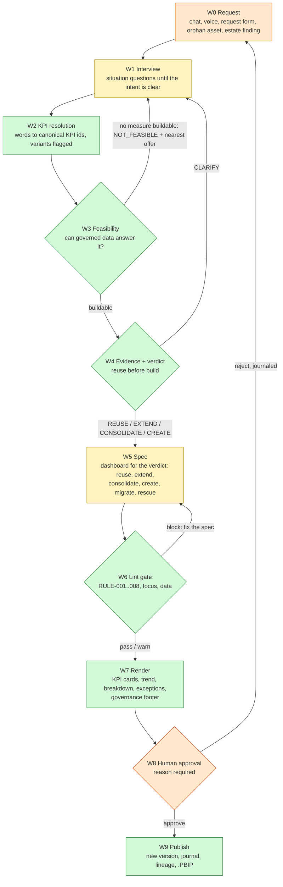
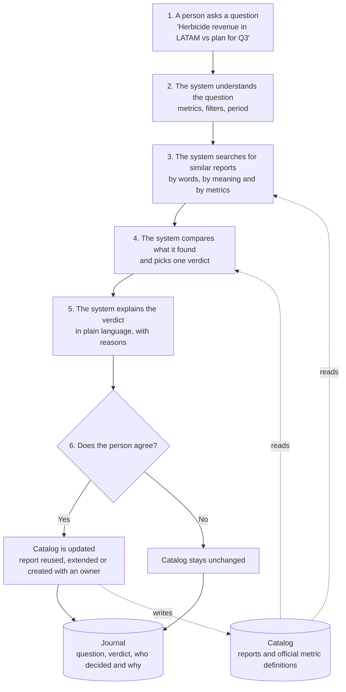
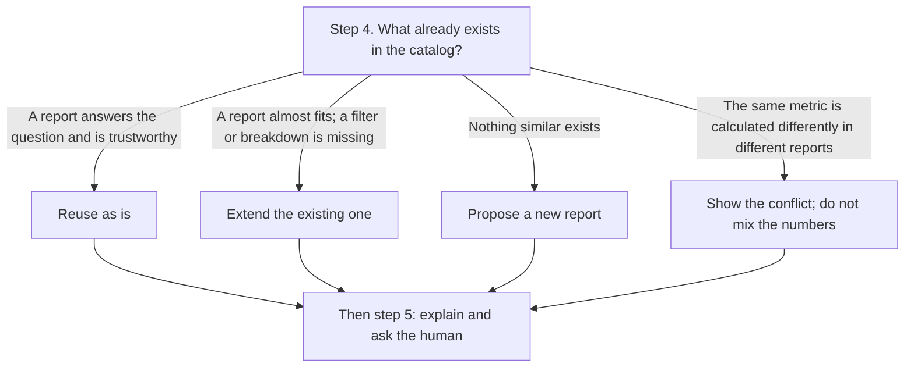
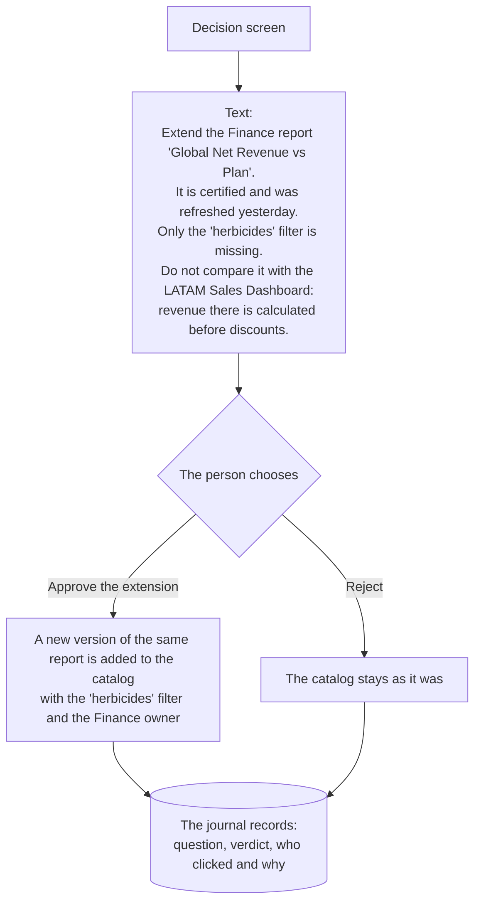

# SinceAI 2026 workspace: BI Steward (Bayer challenge)

For any business question, BI Steward first looks for what already exists, checks whether it can be trusted,
and only then allows something new: REUSE, EXTEND, CREATE or CLARIFY, approved by a human and journaled.
Challenge notes: docs/challenge/. Design: docs/steward/architecture.md.

## How it works

**The Dashboard Factory (plan v2).** Every request ends in one governed decision and the dashboard that decision implies.
Yellow steps use a language model; everything else is deterministic Python. Gates stop the flow until they pass.



The three diagrams below are the detail of W4-W8 as first designed:
Diagrams from Vlada's bi-steward skeleton, drawn before the Bayer brief was released. The flow is still how the app works;
the herbicide/LATAM example comes from the invented sample catalog (Crop Science, out of scope for the challenge), and the
current build adds the intake check, KPI-id matching on the data pack and the Orphan rescue tab. Full write-up: docs/steward/architecture.md.

**The whole flow.** Solid arrows are the question; dashed lines are reads from and writes to the catalog.



**Step 4: choosing the verdict.** A conflict is a warning shown with any verdict. A question with no known metric gets CLARIFY.



**Steps 5-6: what the human sees.** Reject needs a reason; both outcomes are journaled.



After `git pull`: nothing to install. `make test`, then `make ui` (Windows: `.\run.ps1 test`, `.\run.ps1 ui`).

## First run (once, on good Wi-Fi)
```bash
cd ~/SinceAI2026 && ./setup_mac.sh --all
```
Then add one API key to `.env` and run `make ping`.

## Windows teammates
```powershell
winget install --id Git.Git -e; winget install --id GitHub.cli -e   # then reopen PowerShell
gh auth login
cd $HOME; gh repo clone GajusVi/sinceai2026 SinceAI2026; cd SinceAI2026
powershell -ExecutionPolicy Bypass -File .\setup_windows.ps1
notepad .env        # paste your own GEMINI_API_KEY, save
.\run.ps1 ping; .\run.ps1 ui
```
`run.ps1` replaces `make` on Windows: `.\run.ps1 ui | demo | api | eval | ping | models | test`.

## Daily commands
| Command | What |
| --- | --- |
| `make ui` | BI Steward screen (LLM if key, else rules) |
| `make demo` | same screen, LLM off, no network |
| `make ask Q="..."` | one question in the terminal |
| `make ui-old` | pre-event scaffold screen |
| `make eval` | hold-out accuracy, F1, misses |
| `make warm` | record live outputs into demo/cache (Saturday) |
| `make api` | FastAPI on :8000, docs at /docs |
| `make hack` / `make unhack` | keep the Mac awake, network check |

## Friday edits, in order
1. `backend/pipeline.py`: `LABELS`, `URGENT`, prompt.
2. `.env`: `USER_ROLE=`.
3. `backend/models.py`: rename `Item` to the company's noun, add fields the UI needs.
4. `frontend/app.py`: `TITLE`, `TAGLINE`.
5. `demo/inputs.jsonl`: 5-10 real inputs (one wow, one messy, one edge case).
6. `eval/holdout.jsonl`: 20-50 labelled examples, before tuning anything.

Files: `CLAUDE.md` (architecture, rules) · `NOTES.md` (team, decisions) · `CHALLENGE_PICK.md` · `submission/` · `docs/`.
