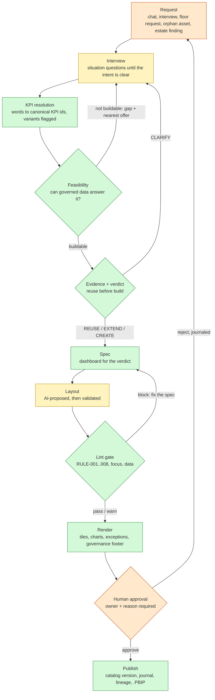

# BI Steward: build less, build better (SinceAI 2026, Bayer challenge)

**Turn a business question into one governed dashboard, and reuse what already exists before building anything new.**

A business user asks a question in plain words. BI Steward finds the governed KPIs, searches the 360 existing reports,
and gives one verdict with evidence: **REUSE, EXTEND, CREATE or CLARIFY**. It then builds the dashboard that verdict
implies, on governed data only, and checks it against Bayer's eight governance rules. A human approves it with a named
owner, and every step is written to a journal. The approved dashboard exports as a Power BI project (.PBIP) that opens
in Power BI Desktop.

> All data is the synthetic SinceAI 2026 Bayer data pack. Product names are real public Bayer brands; every number is
> synthetic and is not Bayer performance.

**Demo video (about 2 min, captions):** [link]
**Challenge:** Bayer, "Build Less, Build Better: AI for Governed Analytics" · **Team:** Donatas Paulauskas, Gajus Viškelis,
Margiris Rakutis, Martynas Kumetaitis

---

## The problem

Self-service BI creates sprawl: duplicate dashboards, the same KPI calculated three ways, reports nobody owns, and
point-and-click artifacts with no version history. In the data pack, 13 of 60 owners have left, 65 reports need a new
owner, and 14 failing semantic models take down 69 reports. AI agents that "just build a dashboard" make this worse.

BI Steward puts the agent in the **creation** process, behind governance gates, so the default answer is reuse.

## What it does (one end-to-end workflow)

1. **Ask.** Chat, a short interview, or a one-tap request from the shop floor. Plain words; the interview asks only
   until the intent is clear.
2. **Resolve KPIs.** Words become canonical KPI ids from the KPI catalog (18 canonical metrics, 56 variants). Variants are
   flagged, never mixed.
3. **Feasibility.** Can governed data answer it? A KPI that is governed but has no source data is shown as a labelled
   **gap**, never as an invented number.
4. **Evidence and verdict.** Search the 360 assets by words, meaning and KPI structure, and weigh trust (certification,
   refresh health, owner status, usage). The verdict is rule-based code, and it cites its evidence.
5. **Spec and render.** The dashboard for that verdict: KPI tiles with status against governed thresholds, trend versus
   forecast, breakdowns, exceptions, and a governance footer (owner, source model, version). Managers and the BI team get
   a production-style **overview** page; workers get a short glance view.
6. **Lint gate.** Every spec is checked against RULE-001..008 plus focus and data rules. A blocking finding disables
   approval.
7. **Human approval.** A builder approves or rejects with a reason and an owner. The approval creates a new catalog
   version (provisional for 30 days) and a journal line with the spec hash.
8. **Publish.** Download a .PBIP project. The export of an approved overview was opened and refreshed in Power BI
   Desktop, and its four KPI cards match the app's numbers.

The **Catalog health** tab works the other direction: duplicates, stale and orphaned reports, retire candidates, and
Tableau-to-Power BI items that should be rationalised instead of migrated 1:1 (RULE-006).

## How it works

Yellow steps use a language model; everything else is deterministic Python. Gates stop the flow until they pass.



### AI approach
- **Where the model is used:** parsing the question and the interview, the plain-language explanation of a verdict, the
  takeaway line, and proposing a dashboard layout. Default provider is Google Gemini; Claude, OpenAI-compatible
  endpoints and local Ollama are supported (`steward/llm.py`, `backend/llm.py`).
- **Where it is not used:** the verdict, KPI resolution, feasibility, numbers and governance checks are deterministic
  code. The model can never invent a KPI id, a number or an approval. Every model output is schema-validated (Pydantic)
  and checked against the catalog. Invalid output gets one repair attempt, then falls back to rules, and the screen says
  which path was used.
- **Reproducible demo:** live answers are cached (`demo/cache`, `steward/layout_cache`). `make demo` replays them with no
  network and no API key.

### Governance controls
| Control | Where |
| --- | --- |
| Reuse before build (RULE-001): every request is checked against all 360 assets first | `steward/search/`, `steward/decision/` |
| Canonical KPI first (RULE-002): variants flagged, never mixed in one tile | `steward/semantic.py`, `catalog/` |
| Owner required (RULE-003): approval needs a named, active owner | `steward/governance.py` |
| Lineage and impact (RULE-004), trust for high reach (RULE-005), no 1:1 migration of waste (RULE-006) | `steward/health.py`, `steward/lint.py` |
| Explain every action with evidence (RULE-008): the verdict cites assets, usage, owner and refresh status | `steward/explain.py` |
| Lint gate: a blocking rule disables the approve button | `steward/lint.py` |
| Human in the loop: approve / reject with reason; new version is provisional for 30 days | `steward/governance.py` |
| Audit trail: question, verdict, spec hash, who decided and why, append-only | `data/steward/journal.jsonl` |
| Role-based access: worker / manager (own plant only) / BI builder | `steward/auth.py` |

### Enterprise BI integration
- **Power BI:** every approved dashboard exports as a .PBIP project (semantic model + report, visual positions from the
  layout grid). Verified in Power BI Desktop: opens, refreshes, numbers match (`steward/pbip.py`, `templates/pbip/`).
- **Version control:** the spec is a JSON document with a stable hash, so a dashboard has a diff and a history, which
  point-and-click reports don't have.
- **Catalog:** reads the same metadata a real estate exposes (assets, KPI map, semantic models, lineage, usage,
  governance signals, migration backlog). Pointing it at a Power BI / Purview scan instead of the Excel pack means
  swapping the loader.

### Data assumptions
- Source: `data/bayer/Bayer_Pharmaceuticals_SinceAI_2026_FINAL_Builder_Data_Pack.xlsx` (synthetic, v2.0), used as given.
- Plants, people and departments for the role-based views are our own synthetic additions (labelled `synthetic`).
- The data pack has no labels, so we wrote our own: 73 labelled cases (data-pack business requests, golden cases,
  a hold-out set and negative cases). Six hold-out labels were revised after review; both scores are reported below.
- KPIs that are governed but have no source data (e.g. Gross-to-Net Rate, Budget Variance) are shown as gaps.

## Proof

| Check | Result |
| --- | --- |
| Verdict accuracy, 73 labelled cases (rules path and intent path) | 73 / 73 |
| Hold-out (25 cases) on the original labels, before the six revisions | 19 / 25 (76 %) |
| False REUSE (recommending a report that does not answer the question) | 0 of 69 |
| Intent extraction, 40 cases: metrics, products, regions | F1 1.00 |
| All 150 data-pack business requests through the full pipeline | 0 errors, 50 specs built, lint pass 100 % |
| Automated tests | 472 passing |

Run it yourself: `make eval` (writes `eval/results.json`). Numbers are from the rules path with the LLM off, so they
are reproducible. **Honest limits:** the hold-out was written by us, not by Bayer users; the 980-probe stress test
shows that the engine still proposes CREATE in some cases where only a KPI variant differs (`eval/results.json` →
`probes`).

## Run it

**No API key needed** for the demo: it replays recorded AI answers.

```bash
./setup_mac.sh          # once; or: uv venv && uv pip install -r requirements.lock.txt
make demo               # browser UI, LLM off, deterministic
make ui                 # live AI (put GEMINI_API_KEY in .env)
make app                # desktop app (pywebview) from source
make test               # 472 tests
```
Windows: `powershell -ExecutionPolicy Bypass -File .\setup_windows.ps1`, then `.\run.ps1 demo`.

**Demo accounts** (mock login, not real security):

| User / password | Role | What to try |
| --- | --- | --- |
| Manager07 / Manage123 | Plant-B manager | "How is Plant-B doing?" → overview dashboard |
| Builder12 / Admin123 | BI team, whole company | "Xarelto net sales in Germany" → REUSE AST-0191; approve a request; Catalog health |
| Worker21 / Worker123 | Plant-A worker | floor buttons; request a missing number |

## Repository map
| Path | What |
| --- | --- |
| `steward/` | engine: search, decision, semantic layer, spec builder, lint, render, governance, health, PBIP export |
| `frontend/` | Streamlit app (`steward_app.py`), design system (`ui.py`, `steward.css`) |
| `app/` | desktop shell (login, packaging) |
| `prompts/` | every LLM prompt, as YAML |
| `eval/`, `tests/` | labelled cases, eval harness, tests |
| `docs/challenge/` | brief, data pack notes, Q&A with Bayer |
| `docs/steward/` | architecture, design system, demo script |

## AI tools and prior work
- Runtime models: Google Gemini (default), with Claude / OpenAI-compatible / Ollama as alternatives.
- Coding assistance: Claude Code. Four team members worked in parallel through a shared board in the repo (`coord/`).
- Prior work: tag `pre-event` (5 Nov 2026) is a generic scaffold (LLM client, config). Everything after it was built
  during the event. Third-party assets: `THIRD_PARTY_NOTICES.md`.
