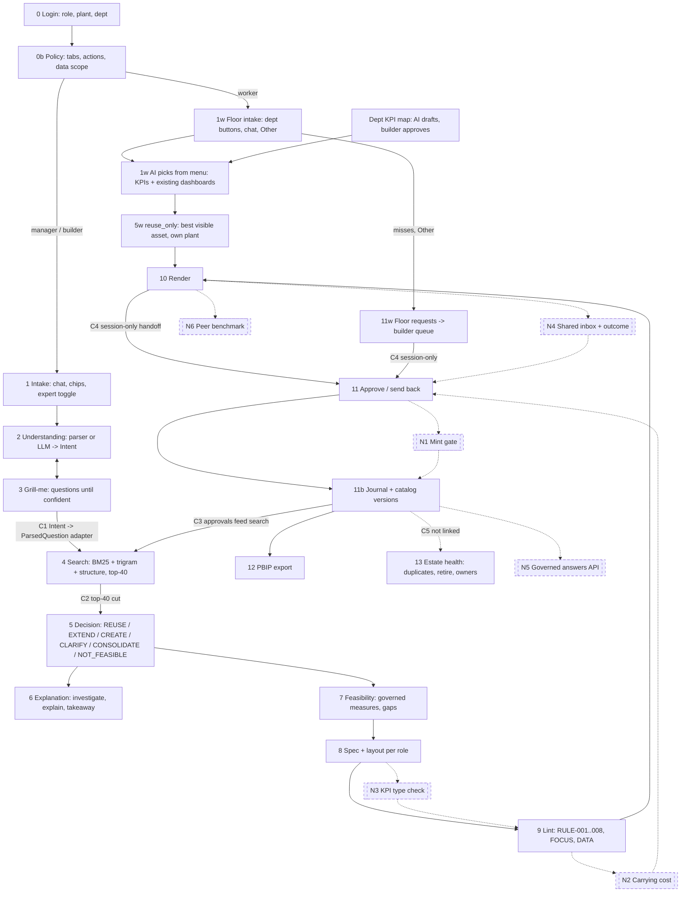

# The chain as one logic graph: nodes, connectors, 0-to-1 ideas, optimisation plan (Gajus, Sat 7 Nov 19:10)

Addendum to `gajus.md`, written after reading gajus.md, donatas.md and martynas.md on main (0e20c10). Every idea
below was checked against those three; where one is adjacent, the earlier author is cited and only the new part is
claimed. Evidence = commands run on main, rules mode, original pack unless stated.

## 1. The chain, start to end

### Connectors (where the chain leaks)
| # | Connector | What crosses it | Status | Who found it |
|---|-----------|-----------------|--------|--------------|
| C1 | Intent -> ParsedQuestion | metric ids vs labels | 5 of 21 sweep cases flip to CREATE | Gajus F1, Donatas confirmed |
| C2 | Search -> Decision | top-40 text hits | decides on a truncated set | Gajus F2 |
| C3 | Journal -> Search | approved extensions re-enter the catalog | rehearsals change stage verdicts | Donatas TL;DR 3 |
| C4 | Request -> Approver | the ruling / floor request object | lives in `st.session_state`: a second browser never sees it | Gajus node 11 (observed); here: the fix |
| C5 | Journal -> Health | approvals, owners, specs | separate scan, no shared state | Donatas bold idea |
| C6 | Spec -> what the viewer saw | role views | 3 hashes, 1 approved | Martynas S2 |
| C7 | Measure -> number | aggregation of ratios and stocks | unweighted means (below) | Martynas A3 (symptom); here: the type system |
| C8 | Pack -> every loader | the xlsx | 8 `read_excel` call sites; 36-46 s on the large pack | Martynas A4 |
| C9 | Floor request -> builder "Start it" | the need | re-sent as **free text** ("Line downtime for Plant-A") and re-parsed: the structure the worker gave is thrown away | new |
| C10 | Approved dept map -> "what is missing" | missing data per department | `worker.LACKS` is hard-coded; the AI draft's `missing` field is never used | new |

C7 evidence (latest month, net-sales rows only):
| Scope | KPI | Simple mean (shipped today) | Units-weighted |
|---|---|---|---|
| Plant-A | Inventory coverage | 6.92 weeks | 7.60 weeks |
| Plant-B | OTIF | 78.3 % | 77.0 % |
| Plant-C | OTIF | 83.3 % | 82.4 % |

## 2. 0-to-1 ideas (new; adjacent work cited)

**Z1. Earned permanence: answers are free, assets are earned.** *(Node N1, between Approve and Journal.)*
Today every approved CREATE/EXTEND mints a permanent catalog asset. Invert it: an approved answer is an **ephemeral
view** (governed measures, rendered on demand, no catalog entry, expires after 30 days). It is minted as an asset only
when demand repeats: the same intent signature (KPI ids x scope x grain) from N distinct people or teams within T days.
Every minted asset is born with a **sunset date** and a renewal test (still asked for? still used?).
- Why 0-to-1: "build less" stops being a recommendation and becomes the default physics of the estate. Sprawl cannot
  happen at birth, only through demand.
- Adjacent: Gajus B2 (demand ledger) ranks priorities from demand; Donatas's build-less meter counts what was avoided.
  Neither changes **when an asset exists**. That is the new part.
- Effort M (3 h): intent signature = sorted KPI ids + filters; a counter in the journal; `Governance.approve` writes
  `ephemeral` until the threshold.

**Z2. Every dashboard has a carrying cost, and teams have a budget.** *(Node N2, between Lint and Approve.)*
Each spec gets a monthly cost estimate from data already in the pack: refresh frequency, table and measure count of
its semantic model, number of KPI variants, owner load (assets per owner). The approve screen shows "this adds ~X
maintenance hours per month to BI Team EMEA (budget 120, used 113)". Over budget = one in, one out: the approver must
pick an asset to retire (the retire funnel already proposes candidates).
- Why 0-to-1: IT's pain (Panu: "minimise the maintenance vector") gets a unit. Every other team shows counts of
  dashboards; nobody prices them.
- Effort M (2-3 h): cost function in code, budget per workspace in config, one line on the approve card.

**Z3. Dashboards are judged by decisions, not views.** *(Extends Grill-me -> Spec -> Health.)*
Builds on Martynas bold 1 (a mandatory *why this exists*) and Donatas's floor push (threshold crossings). The new
part is the **health signal**: each asset carries a decision rule from the interview ("if OTIF < 90 %, expedite"); when
a viewer sees it crossed, one tap logs "acted on it". Estate health then ranks assets by decisions enabled per month;
an asset with views but zero decisions in 90 days is a retire candidate even if its usage looks healthy.
- Why 0-to-1: usage logs measure attention; this measures value. The data pack's own trap (usage does not track
  lifecycle labels) is solved by a better signal, not a better heuristic.
- Effort M (3 h): `Intent.decision_supported` exists; add a threshold, a button, a counter.

**Z4. Benchmark without access.** *(Node N6, in Render for worker and manager.)*
A worker sees "Plant-A OTIF 82 %: 3rd of 10 plants, best is 91 %" without access to any other plant's rows. Code
computes ranks over all plants and returns only the rank, the count and the best value (minimum group size 5, no
plant names below the user's scope). The large pack has 10 plants + CMO (`make pack-large`), so this is demonstrable.
- Why 0-to-1: governance usually removes context; this adds context without breaking the access rule. The floor gets
  "am I doing well?" in one number.
- Effort S-M (2 h): `semantic.compute` per plant, one card line.

**Z5. A type checker for KPIs.** *(Node N3, between Spec and Lint.)*
Every governed measure gets a semantic type in `measures.json`: additive (units, sales), ratio (OTIF, forecast
accuracy: weighted by its denominator), stock (inventory weeks: weighted, or last value over time), index. The spec
compiler refuses an aggregation that breaks the type, and picks the right one for each grouping (plant, product,
quarter). It catches C7 by construction and every future pack's equivalent.
- Builds on Martynas A3 (he found the unweighted means and suggested a README note). The checker is the new part.
- Effort S-M (2 h): 12 measures, a type column, weighted DAX + pandas in two places.

**Z6. The catalog answers every AI in the company, not only our screen.** *(Node N5, after Journal.)*
Expose the approved, governed answers as an API and an MCP tool: `answer(kpi, scope, period)` returns the number,
the governed definition, the asset that owns it, the spec hash and the owner. Copilot, chat assistants and agents
then quote governed numbers with provenance instead of inventing KPIs from raw tables.
- Why 0-to-1: the dashboard stops being the endpoint. The governance layer becomes the source of truth for every
  AI interface Bayer adds next year; that is the moat, and it is why reuse matters even more as AI spreads.
- Effort S for a demo (1-2 h): `backend/main.py` already runs FastAPI; one GET route on `semantic.compute` + the
  journal. MCP wrapper later.

## 3. Optimisation plan (ranked for the build window that is left)

Assumes the build resumes ~21:15 and freezes 02:00 (about 4.5 h for four people). Items from other audits are listed
by their author's id so DECISION.md can merge them; new ones are marked **new**.

| Rank | Change | Fixes | Effort | Owner suggestion | Source |
|---|---|---|---|---|---|
| 1 | One understanding pipeline with ids (F1) + eval on the novice path | C1 | S-M | Gajus | Gajus F1 |
| 2 | Period is a first-class field ("this quarter") | silent drop | S | Donatas + Martynas (model side) | Donatas TL;DR 2, Martynas O1 |
| 3 | Clean data dir per demo + approvals do not poison search on stage | C3 | S | Margiris | Donatas TL;DR 3 |
| 4 | **Shared inbox**: approval queue, floor requests and grants in one JSON store in the data dir (pydantic dumps); outcome shown back to the requester ("approved by Builder12" / "sent back: reason") | C4, multi-user test | S (45 min) | Gajus | **new** (Donatas opt 7 covers the send-back message; this is the store under it) |
| 5 | Floor request carries structure: "Start it" passes `Intent(metric_ids, sites=[plant])` to `ask_intent`, never text | C9 | S (30 min) | Gajus | **new** |
| 6 | Weighted aggregation for OTIF, forecast accuracy, inventory coverage (Z5 light: types for the 3 ratio/stock KPIs only) | C7 | S (1 h) | Martynas | Martynas A3 + Z5 |
| 7 | Cache the parsed pack (parquet by mtime) + fix the quadratic duplicate scan | C8, health 22 s | S | Martynas | Martynas A4, H3 |
| 8 | Fan out explain / investigate / layout / takeaway in parallel + circuit breaker on 429 | latency, stage risk | S | Margiris | Gajus O2, Donatas opt 1 |
| 9 | Department gaps come from the approved map's `missing` (AI-drafted, builder-approved), `LACKS` only as fallback | C10 | S (20 min) | Gajus | **new** |
| 10 | Owner must be an active person from Owners (pick-list) | ownership | S | Donatas | Donatas TL;DR 5 |
| 11 | Pick one 0-to-1 for the pitch: **Z1 earned permanence** (strongest "build less" story) or **Z6 governed answers API** (strongest "why it matters next year") | story | M | team vote | **new** |

What I would not do before the freeze: Z2 budgets and Z3 decision signals (each needs a UI and data to look credible),
the PBIP round trip (Martynas), the value-of-information interview rewrite (Gajus). Put them in the README as the
roadmap: judges score the idea and the honesty about scope.

## 4. New logic nodes, in one line each
- **N1 Mint gate** (Approve -> Journal): ephemeral until demand repeats; sunset date at birth. (Z1)
- **N2 Carrying cost** (Lint -> Approve): hours per month and the team budget on the approve card. (Z2)
- **N3 KPI type check** (Spec -> Lint): aggregation follows the measure's type. (Z5, rank 6)
- **N4 Shared inbox + outcome** (Render -> Approve -> requester): one store for every handoff; the requester sees the result. (rank 4)
- **N5 Governed answers API** (Journal -> outside world): the catalog answers other AIs with provenance. (Z6)
- **N6 Peer benchmark** (Render): rank among plants without row access. (Z4)
