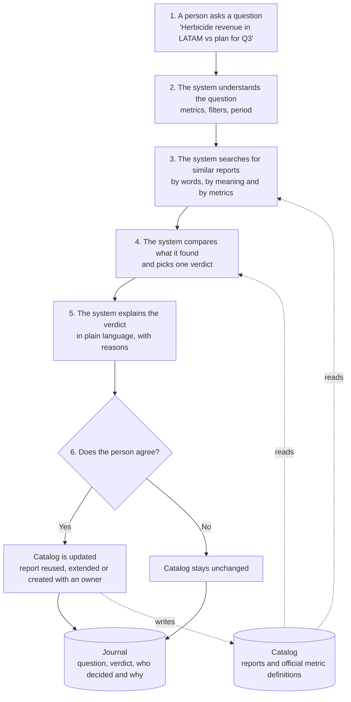
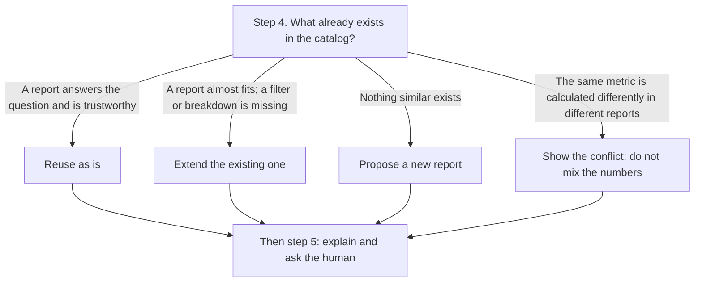
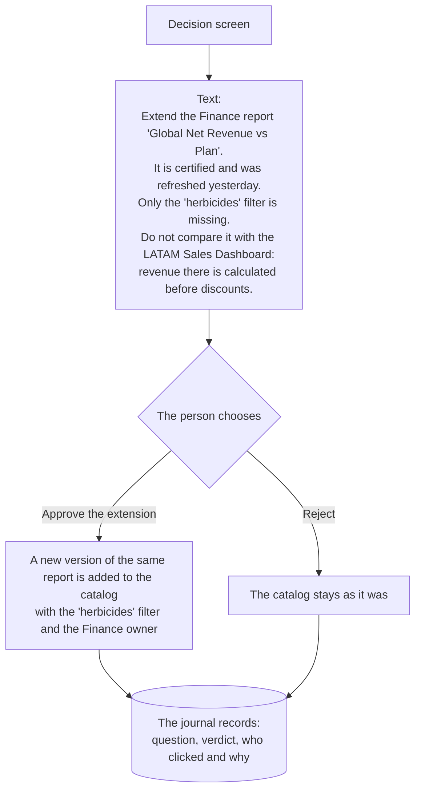

# BI Steward architecture

> **Skeleton-era document.** Written with Vlada's bi-steward skeleton (vladafink/bi-steward), before the Bayer brief was released. The flow and the verdict logic still describe the app. Out of date: the running example (herbicide revenue in LATAM) comes from the invented sample catalog and is Crop Science, which the challenge excludes; the current build also adds an intake check (request text vs its metadata, CLARIFY on conflict), KPI matching by ID on the data pack, and the Orphan rescue tab. Current decisions: NOTES.md and docs/BUILD_PLAN.md.

## The idea in one paragraph

AI builds new dashboards in minutes, and companies drown in hundreds of overlapping reports with different numbers and no owners. BI Steward works the other way round: for every business question it first looks for what already exists, checks whether it can be trusted, and proposes reuse or an extension. A new report is created only when nothing suitable exists, and only with an owner and the official metric definition. A human always has the final word.

The example that runs through this document:

> "What is herbicide revenue in LATAM vs plan for Q3?"

## Overview

The question flows top to bottom through steps 1–6. The catalog is a store, not a step: the system reads it in steps 3 and 4 and writes to it only after a human approves.



Dashed lines are store access. Solid arrows are the flow of the question.

## Step 4: choosing the verdict



A conflict is not a separate path but a warning shown alongside any of the three verdicts. There is also a fourth verdict, **CLARIFY**: if the question contains no known metric, the system asks for clarification and offers nothing to approve.

## Steps 5–6: what the human sees

From step 5 on, the system has already decided. It only explains the decision and waits to learn whether it may write it to the catalog.



The button depends on the verdict:

| Verdict | Button | What changes in the catalog |
|---|---|---|
| REUSE | "Open this report" | Nothing. The journal notes that an existing report was reused |
| EXTEND | "Approve the extension" | A new version of the same report; the old one is marked `superseded` |
| CREATE | "Create the report" | A new report in `draft` status, always with an owner |
| CLARIFY | none | Nothing |

"Reject" requires a reason and changes nothing in the catalog, but it is also journaled. Otherwise nobody can tell later why similar reports keep multiplying.

## Components

Each step is a separate module with a clear input and output, so they can be built in parallel.

| Step | Module | Input → output | Done by |
|---|---|---|---|
| Catalog | `catalog/*.json`, `steward/catalog.py` | files → `Catalog` | data |
| 2. Parsing | `steward/query_parser.py`, `steward/linking.py` | text → `ParsedQuestion` | rules or Claude |
| 3. Search | `steward/search/` | `ParsedQuestion` → list of `SearchHit` | code |
| 4. Verdict | `steward/decision/` | candidates → `Decision` | rule-based code |
| 5. Explanation | `steward/explain.py` | `Decision` → text | template or Claude |
| 6. Approval | `steward/governance.py` | `StewardResult` + human decision → `JournalEntry` | human and code |
| Health | `steward/health.py` | catalog → duplicates, stale reports, retirement candidates | code |
| Full flow | `steward/pipeline.py` | `Steward.ask(text)` → `StewardResult` | code |
| LLM client | `steward/llm.py` | prompt → JSON or text | Claude (default) or Gemini |

### Catalog and metric dictionary

The catalog is the "library shelves": every existing report, dashboard and dataset. For the hackathon these are JSON files in `catalog/`. In a company it would be a real catalog: Power BI, Tableau, Collibra, DataHub.

- `artifacts.json` — a card for every report: which metrics and with which formula, which breakdowns, hard filters (e.g. LATAM only), owner, certification, refresh date, views, version family.
- `metrics.json` — the dictionary of official metrics: formula, owner, synonyms. For example, `net_revenue = sum(invoice_amount) - sum(discounts) - sum(returns)`.
- `dimensions.json` — breakdowns and their values with synonyms: "latin america" → `LATAM`, "herbicides" → `herbicides`.

Synonyms are stored in English and Russian, so teams can ask in either language.

The sample catalog deliberately contains problems the system must find:

| Planted problem | Where |
|---|---|
| "Revenue" with the gross revenue formula | `cs-latam-001`, `cs-insect-001` |
| "OTIF" with a different formula | `sc-otif-002` |
| Copies of the margin report with no owner | `fin-margin-002`, `fin-margin-003` |
| An old duplicate of the revenue report | `fin-rev-002` |
| A report restricted to one division | `ch-rev-001` |
| A metric in the dictionary with no report | `co2_emissions` |

### Step 2. Parsing the question

The output is a structure instead of a sentence:

```json
{
  "metrics": ["net_revenue", "plan_revenue"],
  "filters": {"product_line": "herbicides", "region": "LATAM"},
  "dimensions": ["quarter"],
  "period": "Q3"
}
```

There are two parsers:

- **Rules** (`RuleBasedParser`) — uses the dictionary synonyms. Synonyms are word stems: "revenu" matches "revenue" and "revenues". The longest match wins, so "gross revenue" becomes `gross_revenue`, not `net_revenue`. Works without a key and is the fallback.
- **Claude** (`LLMParser`) — understands free-form wording. The model's answer is validated against the dictionary: metrics and values that are not in it are dropped. If the model fails or finds nothing, the rule-based parser is used.

If the question filters by a dimension ("in LATAM"), that dimension does not count as a breakdown. A period like "Q3" adds a requirement for the "quarter" breakdown.

### Step 3. Search

Three search methods, because each one catches something different:

| Method | File | What it catches |
|---|---|---|
| By words | `lexical.py` | Exact words in the title and description (BM25) |
| By meaning | `semantic.py` | Similar wording. Offline: character trigrams; with Gemini: Gemini embeddings. Claude has no embeddings API, so with Claude the offline embedder is used |
| By structure | `structural.py` | Metrics (weight 2) and breakdowns (weight 1) shared with the question |

Questions and report cards are both enriched with metric and dimension names from the dictionary, so a question in Russian still matches English report cards. The three rankings are merged with RRF: `score = Σ 1 / (60 + rank)`. A report ranked high in all three lists beats one that is first in only one.

### Step 4. Verdict

The language model plays no part here: the decision must be explainable and identical on every run.

**Coverage** (`signals.coverage`) — the share of the question a report covers. Each metric, filter and breakdown in the question is one unit.

- A metric counts only if the report's formula matches the official one. "Revenue" with the gross formula does not count as net revenue.
- A filter counts if the report is already restricted to that value or has that breakdown.
- A quarter can be built from months. It cannot be built from weeks: they do not split evenly into quarters.
- A report is **incompatible** if it is hard-restricted to another value (EMEA when LATAM was asked) or restricted to something not asked about (Consumer Health only). Such a report cannot be reused or extended.

For the main example, `fin-rev-001` has both metrics, region and quarter, but no product breakdown. Coverage is 4 of 5, i.e. 80%.

**Trust** (`signals.trust`) — from 0 to 1:

| Signal | Points |
|---|---|
| Certified | 0.40 |
| Has an active owner | 0.20 |
| Refreshed ≤ 7 days ago / ≤ 30 / ≤ 90 | 0.25 / 0.15 / 0.05 |
| Views in 30 days ≥ 50 / ≥ 10 | 0.15 / 0.05 |

**Candidate ranking:** `0.6 × coverage + 0.3 × trust + 0.1 × search`. Compatible reports always rank above incompatible ones.

**Rules** (`decision/engine.py`, thresholds in `steward/config.py`):

1. No metric in the question → **CLARIFY**.
2. Coverage 100% and trust ≥ 0.6 → **REUSE**.
3. The required metric is present and coverage ≥ 50% → **EXTEND**. If coverage is 100% but trust is low, the extension is to assign an owner, certify or refresh.
4. Otherwise → **CREATE**.

**Conflicts** (`decision/conflicts.py`) are searched across the whole catalog for the metrics in the question: the metric label in a report points to an official metric, but the formula differs.

### Step 5. Explanation

`TemplateExplainer` builds the text from the decision: what to do, why (certification, owner, freshness, views), what is missing, where the conflict is. `LLMExplainer` rewrites this draft in natural language. The prompt forbids the model from changing the verdict, the report, the numbers or the list of gaps. If the model fails, the template text is shown.

### Step 6. Approval and journal

`Governance` stores changes on top of the original catalog in `data/catalog_changes.json`, and the journal in `data/journal.jsonl`. The source files in `catalog/` never change, so the demo is easy to reset.

- **EXTEND**: a new version `{family_id}-v{N}` with the missing breakdowns and metrics. The old version is marked `superseded` and drops out of search. If certification was missing, approval by the owner grants it. Afterwards the same question gets **REUSE** for the new version; the test `test_approved_extension_becomes_reusable` checks this.
- **CREATE**: a new report in `draft` status built on official metrics. It cannot be created without an owner.
- **Reject**: only with a reason.

### Catalog health

`health.py` looks at the catalog as a whole, without a question:

- **duplicates** — reports from different families with the same set of metrics and similar breakdowns or descriptions (MinHash). The more trusted one is proposed to keep;
- **stale** — not refreshed for more than 90 days;
- **no owner** — the owner is missing or inactive;
- **retirement candidates** — duplicates and stale reports that are barely used.

This is the second half of the answer to the challenge: not only stop producing new clutter, but also remove what is redundant.

## Data model

The main models in `steward/models.py`:

```
Artifact          report in the catalog: metrics[label, formula], dimensions, filters,
                  owner, certified, last_refreshed, views_30d, family_id, version, status
MetricDefinition  official metric: id, name, formula, owner, synonyms
ParsedQuestion    metrics, filters, breakdowns, period
Candidate         report + coverage, trust, gaps (Gap), compatibility, final score
Decision          verdict, best candidate, alternatives, conflicts, reasons
StewardResult     question + decision + explanation
JournalEntry      who, when, question, verdict, approved or rejected, reason
```

## Where the language model is used and where plain code is

| Step | Who | Why |
|---|---|---|
| Parsing the question | Claude, fallback: rules | A model understands free text better |
| Search by meaning | Offline trigrams (Gemini embeddings if Gemini is the provider) | Compares meaning, not words |
| Search by words and structure | Code | Fast and precise |
| Verdict | Rule-based code | Explainable and repeatable |
| Explanation | Claude, fallback: template | Natural-sounding text |
| Approval | Human | Accountability |

Everything works without a key. This matters for the demo: no internet, no problem.

## What was taken from `zenzap-ai-search`

| Idea | Source | Where it lives here |
|---|---|---|
| MinHash for text similarity | `data_preprocessing/documents/minhash_calculator.py` | `steward/decision/minhash.py`, ported unchanged |
| Duplicate decisions: NEW, DUPLICATE, VERSION, version family, audit | `data_preprocessing/documents/dedupe_models.py`, `README.md` | REUSE / EXTEND / CREATE verdicts, `family_id`, `version`, `superseded`, journal |
| Rank fusion with RRF, k = 60 | `search/reranker/rrf.py` | `steward/search/rrf.py` |
| Hybrid search: words + meaning + metadata | `search/hybrid_search.py` | `steward/search/engine.py`, simplified, without Qdrant |
| Linking "NYC" and "New York" to one entity | `data_preprocessing/shared/entity_linking/` | synonyms → official metric in `steward/linking.py` |
| Prompts in YAML, separate from code | `llm_config/prompt_loader.py` | `prompts/*.yaml`, `steward/prompts.py` |
| Validating the LLM response before use | `data_preprocessing/shared/llm_response_validator.py` | `LLMParser._validate` |
| Evaluation on reference queries | `scripts/eval_*.py` | `tests/golden_questions.json` |

Not ported: Qdrant, the BGE-M3 model, the cross-encoder reranker, OCR and document parsing. For a catalog of a few dozen reports this is unnecessary infrastructure. If the catalog grows to thousands of artifacts, the next step is to port `hybrid_search.py` and the reranker almost as is.
